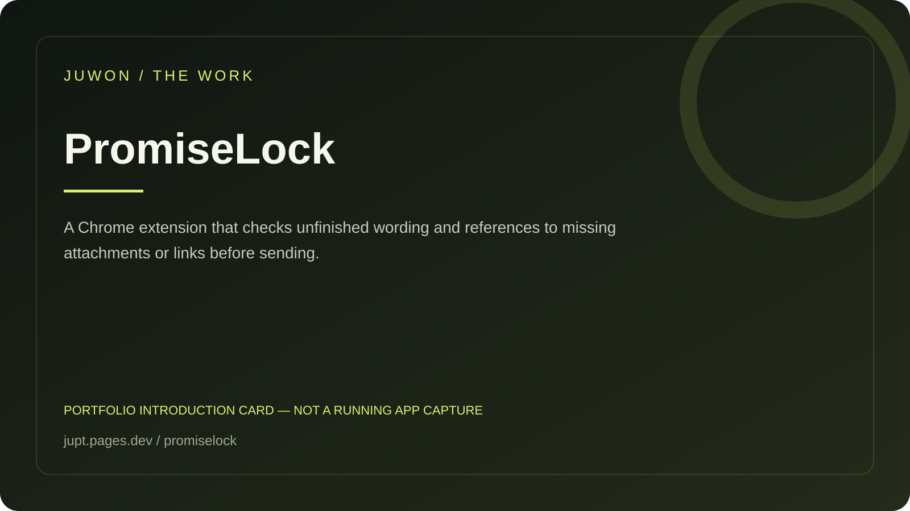

<!-- JUWON-PORTFOLIO-INTRO:START -->
# PromiseLock



*Portfolio introduction card, not a screenshot of a running application.*

*포트폴리오 소개 카드입니다. 실행 화면 캡처가 아닙니다.*

## English

A Chrome extension that checks unfinished wording and references to missing attachments or links before sending.

[View JUWON's portfolio](https://jupt.pages.dev/) · [Browse the project collection](https://jupt.pages.dev/projects)

**Scope:** This README presents the repository's documented intent and recorded visual evidence. It does not certify that every feature is complete, deployed, or currently working. Follow the original setup, safety, and license documentation below.

## 한국어

첨부·링크가 없는 약속과 미완성 문구를 전송 전에 확인하는 확장.

[JUWON 포트폴리오 보기](https://jupt.pages.dev/) · [전체 프로젝트 보기](https://jupt.pages.dev/projects)

**확인 범위:** 저장소의 문서상 목적과 기록된 화면 근거를 소개합니다. 모든 기능의 완성·배포·현재 정상 작동을 보증하지 않습니다. 설치법·안전 주의사항·라이선스는 아래 기존 문서를 확인하세요.
<!-- JUWON-PORTFOLIO-INTRO:END -->

---

## Original documentation / 기존 문서

# PromiseLock 🔒

## Stop sending promises your browser cannot prove.

PromiseLock is a local-first Chrome extension that pauses a message when it says:

- “I attached the report” but no file is visible;
- “Here is the link” but no URL is present;
- `[insert final link]`, `TODO`, or another unfinished placeholder remains.

It works at the send button, across browser chats, email composers, support tools, and local web apps. No account. No cloud. No model. No telemetry.

> **The useful moment is one second before embarrassment.**

## Try the demo

```bash
npm ci
npm run demo
```

Open `http://127.0.0.1:4173/`, click **Send message**, then choose **Send anyway once** or keep editing. Add the fake attachment and send again.

## Install in Chrome or Edge

1. Run `npm run build`.
2. Open `chrome://extensions` or `edge://extensions`.
3. Enable **Developer mode**.
4. Choose **Load unpacked** and select this project's `dist` folder.
5. Open a page with a composer, click the PromiseLock toolbar icon, then choose **Enable on this tab**.

PromiseLock requests only `activeTab` and `scripting`. It does not receive permanent access to every site. Chrome internal pages such as `chrome://extensions` may reject injection.

## Safety by design

- Reads only the active composer while the extension is enabled on that tab.
- Keeps detection and review in the browser; sends no message text anywhere.
- Pauses only recognized send controls with a finding.
- Gives one explicit **Send anyway once** choice; never auto-sends.
- Does nothing when composer or send target is ambiguous.
- Uses deterministic rules, not an AI call.

## Development

```bash
npm ci
npm test
npm run typecheck
npm run lint
npm run build
npm run audit
```

The rule engine is pure and separately tested in `src/rules.ts`. The browser adapter is in `src/content.ts`; the demo is `examples/demo.html`.

## What is not promised yet

This is an MVP, not proof that every website's composer is supported. Site-specific DOM structures, shadow roots, keyboard-only send flows, and false-positive rates need real-user testing. The seven-day experiment is documented in [`docs/superpowers/specs/2026-10-02-promiselock-design.md`](docs/superpowers/specs/2026-10-02-promiselock-design.md).

## License

MIT. See [`LICENSE`](LICENSE).
